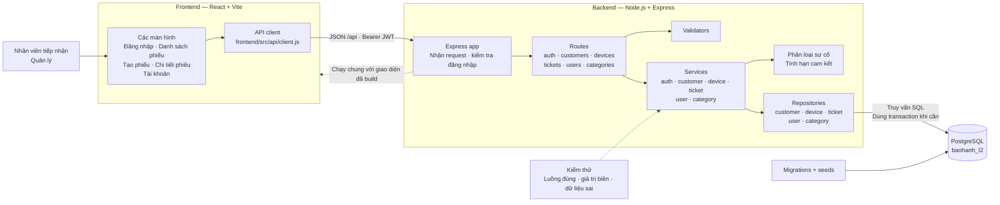

# Sơ đồ kiến trúc thực tế

Sơ đồ dưới đây mô tả cách các phần của chương trình đang kết nối với nhau.

## Cách chương trình hoạt động

- Khi người dùng thao tác, giao diện gửi yêu cầu qua API client. Backend nhận yêu cầu ở route, kiểm tra dữ liệu, xử lý trong service rồi repository đọc hoặc ghi PostgreSQL.
- Các quy tắc phân loại sự cố và tính hạn cam kết nằm trong `src/services/classifier.js` và `src/services/deadline.js`.
- Route xử lý phần HTTP; service xử lý nghiệp vụ; repository chứa câu lệnh SQL. Nhờ tách như vậy, service có thể kiểm thử bằng repository giả mà không cần kết nối database.
- Khi tạo phiếu hoặc đổi trạng thái, hệ thống ghi phiếu và lịch sử trong cùng transaction để tránh lưu dở một phần.
- Migrations tạo bảng, seeds thêm dữ liệu mẫu. Có thể chạy lại các lệnh này theo hướng dẫn trong README.
- Khi build frontend, Express có thể phục vụ cả giao diện lẫn API. Lúc phát triển, Vite chạy riêng và chuyển các yêu cầu `/api` sang backend.

## Tệp triển khai chính

| Thành phần | Tệp/thư mục |
| --- | --- |
| Ghép các phần backend và khởi động máy chủ | `src/app.js`, `src/server.js` |
| Các màn hình và thành phần giao diện | `frontend/src/pages/`, `frontend/src/components/` |
| API client | `frontend/src/api/client.js` |
| Routes | `src/routes/` |
| Services và quy tắc nghiệp vụ | `src/services/` |
| Repositories | `src/repositories/` |
| Kiểm tra đầu vào | `src/validators/` |
| Cấu trúc và dữ liệu mẫu | `migrations/`, `seeds/` |
| Kiểm thử | `tests/` |
