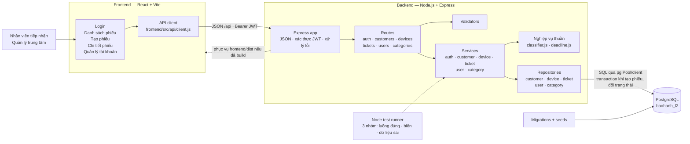

# Kiến trúc thực tế — luồng L2

Sơ đồ này mô tả mã đã hiện thực trong repo, không phải kiến trúc dự kiến ở Bài tập 1. Giao diện và API được phục vụ cùng một ứng dụng Express khi đã build frontend; khi phát triển, Vite chạy riêng và proxy `/api` sang backend.

## Luồng phụ thuộc

- Request nghiệp vụ đi từ giao diện qua API client, Express route, service, rồi repository đến PostgreSQL; kết quả đi ngược về client.
- Route chịu trách nhiệm HTTP. Service nhận dữ liệu và người dùng đã xác thực, thực hiện quy tắc nghiệp vụ, không nhận `req`/`res` và không chứa SQL. Repository nhận kết nối cơ sở dữ liệu qua tham số và thực hiện SQL.
- `classifier.js` và `deadline.js` là các hàm nghiệp vụ thuần được `ticket.service.js` gọi để phân loại sự cố và tính hạn cam kết.
- `authenticate` kiểm tra token trước các route cần đăng nhập. Service tiếp tục kiểm tra quyền quản lý và giới hạn trung tâm ở các thao tác tương ứng.
- Tạo phiếu và chuyển trạng thái dùng transaction để cập nhật phiếu cùng log trạng thái. Migrations tạo cấu trúc; seeds nạp dữ liệu mẫu có thể chạy lại.
- Unit tests chạy bằng `npm test` với repository giả, không cần kết nối PostgreSQL.

## Tệp triển khai chính

| Thành phần | Tệp/thư mục |
| --- | --- |
| Ứng dụng HTTP và ghép phụ thuộc | `src/app.js`, `src/server.js` |
| Giao diện | `frontend/src/pages/`, `frontend/src/components/` |
| API client | `frontend/src/api/client.js` |
| Routes | `src/routes/` |
| Services và quy tắc nghiệp vụ | `src/services/` |
| Repositories | `src/repositories/` |
| Kiểm tra đầu vào | `src/validators/` |
| Cấu trúc và dữ liệu mẫu | `migrations/`, `seeds/` |
| Kiểm thử | `tests/` |
